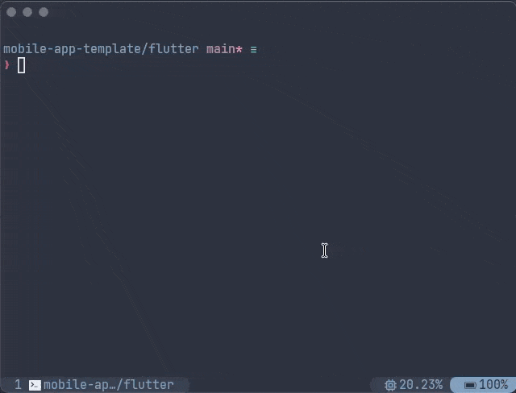

# homebrew-tools

A Homebrew tap for Valian's internal developer tools.

## Available tools

| Tool  | Description                                    | Install                             |
| ----- | ---------------------------------------------- | ----------------------------------- |
| [`frn`](#frn) | Fast `flutter run` launcher with device picker | `brew install valian-ca/tools/frn` |
| [`atelierd`](#atelierd-device) | Atelier dashboard daemon + mobile device bank | `brew install valian-ca/tools/atelierd` |

## Install the tap

```sh
brew tap valian-ca/tools
```

The `homebrew-` prefix is dropped from the tap name by Homebrew convention.

## Upgrading

```sh
brew update
brew upgrade valian-ca/tools/<name>
```

---

## `frn`

Fast `flutter run` launcher with device picker. Implemented in Go; `brew
install` compiles it from source (pulls `go` as a build dependency).



### Why frn?

- **Fast.** Device picker pops in ~200 ms vs `flutter run`'s ~7 s before it even shows devices.
- **Remembers your choice.** Last used flavor + device are persisted per-project in
  `.dart_tool/valian/frn.json` — re-runs are one `<enter>`.
- **Flavors done right.** Auto-detects Android `productFlavors`, iOS schemes, and
  `lib/main_*.dart` entry points. No more forgetting `--flavor development`.
- **VM service URI auto-wired.** Writes to `.dart_tool/valian/vmservice.uri` so other Valian
  tooling can auto-attach — no manual `--vmservice-out-file` flag.

---

## `atelierd device`

The machine-local source of truth for mobile-device attribution: a bank of
simulator/AVD clones that autonomous forge runs lease, release, and recycle
without stepping on each other — or on you.

```sh
atelierd device bank init [--ios N] [--android N]   # provision atelier-ios-1..N / atelier-android-1..N (default 2 + 2)
atelierd device bank limit [N]                      # print or set how many virtual devices may be on at once (default 1)
atelierd device lease --platform ios --session <id> [--wait 15m]  # print a targetable UDID/serial alone on stdout
atelierd device pause --session <id>                # power the session's virtual devices off, keep the lease and the data
atelierd device release --session <id> [--platform ios|android]
atelierd device status                              # bank + physical devices, states, leases, queue
```

- **`bank init`** is idempotent and sizes both ways: re-running tops up;
  shrinking deletes the idle excess clones and keeps a leased or recycling
  one (warned, removed on a later pass). Every unleased AVD in range is
  recreated on the current device profile, a `broken` device is repaired
  and leasable again, and the `bank limit` setting is kept. The Android
  side holds at most 16 AVDs (adb discovers console ports 5554–5584 only).
  A machine missing one toolchain provisions the other side, warns, and
  exits 0.
- **States** — a virtual device is `off`, `on`, `recycling` or `broken`.
  The LEASE column of `status` always starts with the holding session's id
  (`session S, on since 15:04, renewed 12s ago` · `session S, suspended
  since 15:20` · `session S, device died — restarts at next lease`).
- **Ignition limit** — at most `bank limit` virtual devices are on at the
  same time, all sessions and platforms together (default `1`: a running
  AVD takes ~9 GB). A suspended lease does not count; a recycling device
  counts until its power-off is confirmed.
- **`lease`** is idempotent per `(session, platform)`. It powers a device
  on within the limit and in arrival order: when it cannot, the session
  waits in the queue up to `--wait` (default `0`) and exits `10`. The queue
  keeps a session's place across calls and forgets it 2 min after its last
  call's deadline, or at once when the wait is interrupted (Ctrl-C,
  SIGTERM); `status` shows it, the holder of a powered-on device gets a
  warning on stderr from its `atelierd device` and `atelierd forge` commands
  that succeed, and after 10 min of waiting one macOS notification is
  posted. A device that fails to boot goes to recycling; it keeps counting
  toward the limit until its power-off is confirmed, so another device is
  tried as soon as the limit allows, within `--wait`.
  Exit codes: `0` leased, `10` not served within the wait (bank exhausted or
  limit reached), `11` bank not initialized. A connected physical device is
  leased only when the platform has no virtual device left to power on.
- **`pause`** suspends the session's leases: each virtual device is powered
  off with its installed app and data kept, and the session's next `lease`
  powers the same device back on (through the queue when the limit is
  reached). A physical lease is left as it is.
- **`release`** returns immediately — a detached worker powers the virtual
  device off and erases it **without booting it**: it is `off` again within
  5 min (an AVD is wiped by `-wipe-data` on its next boot). A recycle that
  fails twice leaves the device `broken`, its reason shown by `status`, and
  never leased again until `bank init` repairs it. A physical device is
  leasable again on the spot.
- **AVDs start with 4 GB of RAM** (`-memory 4096`), whatever they were
  provisioned with.
- **Lease lifecycle** — every `atelierd emit` and every `device` command
  carrying a session ID renews that session's leases; `hook:session-end`
  releases them; a lease unrenewed for ~1 h, suspended or not, is reaped.
  Every `device` command except `bank limit` also checks the recorded state
  against the simulators and emulators actually running: a device stopped
  by hand is `off` (a leased one restarts at the session's next lease), and
  a virtual device on without a lease is powered off. There is no resident
  daemon: these checks run when a command runs, and the only background
  process is the detached recycle worker a release spawns, bounded to 5 min.
- **`frn` integration** — the picker suffixes bank devices with their lease
  state (e.g. `atelier-ios-1 — bank, on, session abc123 · def456 waiting 12
  min`) so a human avoids stepping on a running forge. frn never takes a
  lease.

State lives in `~/.atelier/devices.json`, guarded by a `flock` so concurrent
leases from parallel sessions never double-book a device. Every state
change is appended to `~/.atelier/device-transitions.jsonl`, one JSON line
with `at`, `device`, `platform`, `from`, `to`, `session`, `reason`, and the device's
`on` / `leased` flags after the change. This lists every stretch a virtual
device spent on without a lease for more than 2 min:

```sh
jq -rs 'def ts: sub("\\.[0-9]+"; "") | fromdateiso8601; group_by(.device)[] | sort_by(.at) | . as $t | range(0; length) as $i | select($t[$i].on and ($t[$i].leased | not)) | ((if $i + 1 < ($t | length) then ($t[$i + 1].at | ts) else now end) - ($t[$i].at | ts)) as $s | select($s > 120) | "\($t[$i].device) on without lease for \($s | floor)s from \($t[$i].at)"' ~/.atelier/device-transitions.jsonl
```

A `reap-unleased-on` line marks a device found on without a lease and
powered off.

## Contributing

See [CLAUDE.md](./CLAUDE.md) for conventions when adding a new tool or
modifying an existing one — naming rules, dependency policy, bash
compatibility notes, and the release process.

### Release process (short form)

1. Commit changes to `bin/<tool>` (and any formula updates) on `main`.
2. Tag a release using a per-tool prefix:
   ```sh
   git tag <tool>-0.1.1
   git push --tags
   ```
3. Compute the tarball's sha256:
   ```sh
   curl -sL https://github.com/valian-ca/homebrew-tools/archive/refs/tags/<tool>-0.1.1.tar.gz \
     | shasum -a 256
   ```
4. Update the formula's `url` and `sha256` in a follow-up commit.
5. Teammates run `brew upgrade valian-ca/tools/<tool>`.

## CI

Every PR and push to `main` runs:

- `go vet ./...`, `go test ./...`, `golangci-lint run` — for Go packages.
- `shellcheck -x bin/*` — when `bin/` contains scripts.
- `brew audit --strict --online valian-ca/tools/<name>` — only when a formula changes.
